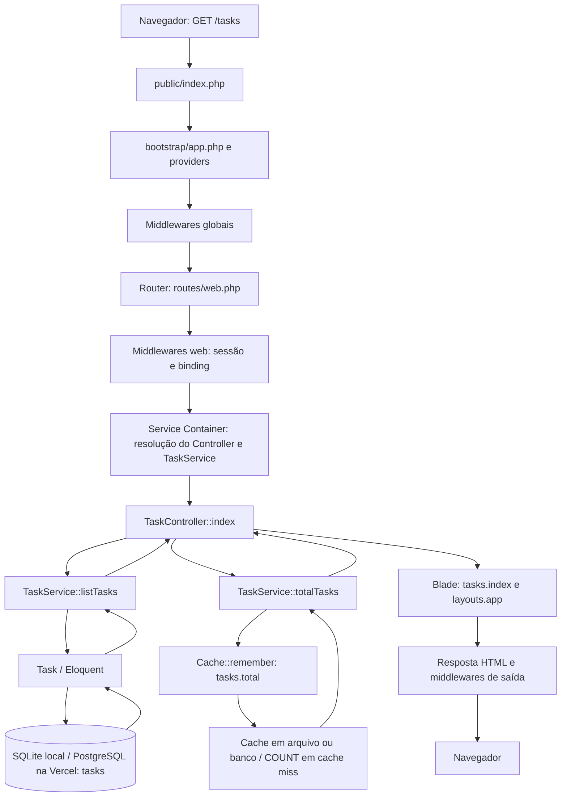

# Laravel Task Manager

Prova de conceito para a disciplina de **Análise e Projeto de Sistemas de Informação do IFAL**. O projeto implementa um gerenciador de tarefas e torna visíveis o MVC com uma camada Service, o fluxo HTTP do Laravel e três mecanismos: **Dependency Injection / IoC**, **Active Record** e **Proxy por meio das Facades**.

A aplicação usa Blade no servidor e CSS próprio, com SQLite na configuração local e PostgreSQL na Vercel. Não é necessário instalar Node ou compilar assets para executá-la. Os documentos de entrada `spec.md` e `roteiro-apresentacao.md` foram preservados.

## Tecnologias e requisitos

Versões verificadas durante a implementação:

| Componente | Versão |
| --- | --- |
| PHP | 8.5.8 |
| Laravel, Eloquent e Blade | 13.44.1 |
| SQLite, biblioteca do PHP | 3.53.4 |
| PostgreSQL usado nos testes de produção | 18.6 |
| Composer | 2.10.2 |
| PHPUnit | 12.5.45 |
| Laravel Pint | 1.32.3 |

Requisitos: **PHP 8.3 ou superior**, Composer 2 e extensões exigidas pelo Laravel, incluindo PDO SQLite, SQLite3, mbstring, DOM/XML, ctype, curl, fileinfo, filter, hash, openssl, pcre, session e tokenizer. Verifique o ambiente com `composer check-platform-reqs`.

O Composer está configurado com `config.platform.php=8.3.0` para selecionar dependências compatíveis com o mínimo especificado. A execução e os testes foram realizados no PHP 8.5.8 disponível neste ambiente, sem execução adicional em PHP 8.3. O `composer.lock` fixa as versões reproduzíveis.

Laravel Boost 2.10.4 foi instalado como dependência de desenvolvimento por exigência do `AGENTS.md` fornecido pelo esqueleto oficial. Não é utilizado pelo fluxo de tarefas.

A injeção do logger de navegador do Boost está desativada por `BOOST_BROWSER_LOGS_WATCHER=false`. A confirmação de exclusão e o painel de fluxo utilizam JavaScript próprio, sem bibliotecas adicionais.

## Executar neste diretório

O ambiente local já foi configurado, com chave gerada, migrations executadas e cinco tarefas de demonstração:

```sh
php artisan serve --host=127.0.0.1 --port=8000
```

Abra **http://127.0.0.1:8000/tasks**. A raiz `/` redireciona para a listagem. Outra opção é `composer run dev`.

Se a porta 8000 estiver ocupada, use `php artisan serve --host=127.0.0.1 --port=8765` e abra http://127.0.0.1:8765/tasks. A verificação HTTP desta implementação foi realizada nessa porta alternativa.

## Instalar em outro ambiente

Na raiz do projeto:

```sh
composer install
cp .env.example .env
php artisan key:generate
php -r "file_exists('database/database.sqlite') || touch('database/database.sqlite');"
php artisan migrate --seed
php artisan serve --host=127.0.0.1 --port=8000
```

O arquivo `.env.example` já configura SQLite, cache e sessões em arquivos, fila síncrona, logs locais, idioma `pt_BR` e fuso `America/Maceio`. Não há serviços externos para configurar. Sem `DB_DATABASE`, o Laravel utiliza `database/database.sqlite`.

Para uma instalação inicial automatizada, use `composer run setup`, que instala dependências, cria `.env` se necessário, gera a chave, prepara o SQLite e executa migrations e seeders. A geração de chave faz esse comando ser destinado à configuração inicial; use `composer install` para atualizar uma instalação existente.

`.env`, o banco SQLite, os logs e `vendor/` são ignorados pelo Git. Não publique a chave local.

## Migrations e dados de demonstração

```sh
php artisan migrate
php artisan db:seed
php artisan migrate:status
```

O seeder usa valores explícitos e títulos fixos, funcionando também sem dependências de desenvolvimento. `TaskFactory` continua disponível para os testes. Em um banco limpo são criadas cinco tarefas: duas concluídas e três pendentes. Executá-lo novamente não duplica os exemplos cujos títulos continuam iguais nem redefine seus estados. O cache do total é invalidado ao final.

Para restaurar exatamente o cenário inicial da apresentação, **apagando todas as tarefas atuais**:

```sh
php artisan migrate:fresh --seed
```

A tabela de domínio é `tasks`. As migrations também preparam `cache`, `cache_locks` e `sessions` para o armazenamento compartilhado na Vercel, além da tabela `migrations` administrada pelo Laravel. Na configuração local, cache e sessões continuam usando arquivos em `storage/framework/`.

## Publicar na Vercel

A implantação usa o [Container Runtime da Vercel](https://vercel.com/docs/functions/runtimes/container), com FrankenPHP e PHP 8.5. O uso de Docker e PostgreSQL nesta opção atende à adaptação solicitada para hospedagem; a configuração local original continua disponível.

### Arquivos de implantação

| Arquivo | Função |
| --- | --- |
| `Dockerfile` | Instala extensões PHP e dependências com `--no-dev`, e monta a imagem de produção. |
| `Caddyfile` | Atende HTTP na porta `PORT` (padrão 80) e publica somente `/app/public`. |
| `docker-entrypoint.sh` | Prepara diretórios temporários e gera caches após receber as variáveis de ambiente. |
| `.dockerignore` | Exclui `.env`, credenciais, SQLite local, logs e dependências locais da imagem. |
| `.env.vercel.example` | Modelo das variáveis de produção, sem credenciais. |

Tarefas, sessões, cache, locks e histórico do painel ficam no PostgreSQL. `/tmp` contém somente arquivos descartáveis, como Views compiladas e manifests do Laravel/Caddy. A escrita no histórico utiliza um lock compartilhado para não perder registros de requisições simultâneas. Consultas internas de sessão/cache são excluídas das etapas de tarefas.

### 1. Preparar o PostgreSQL e as variáveis

Crie ou conecte um PostgreSQL na [Vercel Marketplace](https://vercel.com/marketplace?category=databases). Copie a URL fornecida pelo serviço para `DB_URL`, inclusive parâmetros de TLS/pooling quando presentes. Se a integração criar `DATABASE_URL` ou `POSTGRES_URL`, copie esse valor para `DB_URL`.

Crie um arquivo local exclusivo para preparar esse banco, sem substituir o `.env` de desenvolvimento:

```sh
cp .env.vercel.example .env.vercel.local
php artisan key:generate --show
```

Preencha `.env.vercel.local` com os valores reais:

- `APP_KEY`: a chave `base64:...` gerada pelo comando; mantenha a mesma nos próximos deployments.
- `APP_URL`: o endereço HTTPS do projeto, por exemplo o domínio que você escolheu na Vercel.
- `DB_URL`: a conexão PostgreSQL completa.

Mantenha os demais valores do modelo: `APP_DEBUG=false`, `DB_SSLMODE=require`, `SESSION_DRIVER=database`, `SESSION_ENCRYPT=true`, `SESSION_SECURE_COOKIE=true`, `CACHE_STORE=database`, `LOG_CHANNEL=stderr` e `TRUSTED_PROXIES=*`. O trust de proxies é necessário para reconhecer o HTTPS encerrado pela infraestrutura da Vercel; ele não é ativado no `.env.example` local.

O `.env.vercel.local` é ignorado pelo Git e pela imagem Docker. A URL do banco e a chave devem ficar nos arquivos locais privados e nas variáveis do projeto, nunca em commits ou no Dockerfile.

### 2. Criar as tabelas antes de atender requisições

Com PHP/Composer instalados localmente e a extensão `pdo_pgsql` habilitada:

```sh
php artisan migrate --env=vercel.local --force
# Opcional: criar os cinco exemplos da apresentação.
php artisan db:seed --env=vercel.local --force
```

Esses comandos usam exclusivamente a conexão de `.env.vercel.local`. As migrations não são executadas em cada cold start ou build: execute-as novamente quando houver novas migrations. O seeder é opcional e também funciona numa instalação sem Faker/Boost/PHPUnit. O SQLite local não é enviado nem importado automaticamente para o PostgreSQL.

### 3. Configurar o projeto na Vercel

Envie os arquivos do projeto ao repositório e importe-o na Vercel, ou ajuste o projeto já existente:

| Campo | Valor |
| --- | --- |
| Root Directory | `./`, a pasta que contém `Dockerfile`, `composer.json` e `artisan` |
| Framework Preset | `Container` |
| Build Command / Output Directory | Deixe as opções padrão do Container; o build é definido pelo Dockerfile. |
| Porta HTTP | 80, ou o valor de `PORT` se você alterar a porta. |

Em **Settings → Environment Variables**, cadastre os valores de `.env.vercel.local` no ambiente Production. Depois execute o deploy/redeploy. O Dockerfile na raiz é suficiente para o Container Runtime; não é necessário um runtime PHP comunitário ou um `vercel.json` para esta aplicação. [Guia oficial de PHP com Docker](https://vercel.com/kb/guide/deploy-php-on-vercel-with-docker).

Utilize um PostgreSQL/banco separado para Preview e configure suas respectivas variáveis, evitando que a demonstração de uma branch modifique os dados de Production.

### 4. Conferir a implantação

Abra `/up` (saúde do processo), `/tasks` (banco, sessão e Blade) e `/fluxo` (painel). Crie uma tarefa e confira a requisição em outra aba. Na Vercel o painel identifica **PostgreSQL** e mostra `config/database.php` como arquivo de conexão; o código-fonte contém referências a variáveis de ambiente, sem revelar seus valores.

Os registros `Task created`, `Task updated`, `Task status changed` e `Task deleted` aparecem nos logs de execução da Vercel, enviados por `stderr`. A chave `APP_KEY` estável e o armazenamento compartilhado mantêm a sessão e o histórico entre instâncias/deployments.

Para conferir a imagem localmente quando o Docker estiver em execução:

```sh
docker build -t ifal-task-manager .
docker run --rm --env-file .env.vercel.local -e SESSION_SECURE_COOKIE=false -e APP_URL=http://localhost:8000 -p 8000:80 ifal-task-manager
```

Os dois overrides são somente para testar via HTTP local; mantenha cookies seguros e HTTPS no ambiente Vercel. Os comandos não executam migrations automaticamente.

**Validação realizada:** suíte completa com SQLite e PostgreSQL; instalação `--no-dev`, migrations, seeders e HTTP numa cópia com arquivos da aplicação sem permissão de escrita e diretórios temporários separados. O build da imagem Docker e um deploy real não foram executados: o daemon Docker não estava em execução e a conexão PostgreSQL/chave do projeto Vercel ainda dependem de configuração na conta.

## Testes e verificações

```sh
php artisan test
# Somente os testes de gerenciamento:
php artisan test --compact tests/Feature/TaskManagementTest.php
# Alternativas e verificações:
composer test
composer validate --strict
composer check-platform-reqs
php artisan route:list --path=tasks
```

Os **57 casos de teste, com 322 verificações**, cobrem listagem e ordem, cadastro pendente, limites e tipos inválidos do título, edição, conclusão e reabertura, exclusão, filtros, estado vazio, 404, mensagens flash, escape de HTML, rejeição de escritas sem token no cenário testado, logs, duração e invalidação do cache e repetição do seeder. Incluem 16 testes do painel e sete de persistência para a nuvem: armazenamento em banco, recarregamento de sessões/cache, preservação do feedback, captura somente do SQL de tarefas, fonte PostgreSQL e URLs/cookies HTTPS.

A suíte usa PHPUnit e `RefreshDatabase`; por padrão, SQLite em memória e cache/sessões em memória. Os testes de nuvem exercitam os drivers de banco no mesmo banco isolado da suíte. A suíte completa também foi executada em PostgreSQL 18.6 temporário, com o mesmo resultado. O banco da apresentação permanece separado. O teste de CSRF remove explicitamente o desvio que o framework aplica ao ambiente de testes.

Também foram verificadas respostas HTTP reais: redirecionamento da raiz (302), listagem, filtros, edição e assets (200), tarefa inexistente (404) e cadastro sem token CSRF (419). O painel foi exercitado no Firefox 160 em duas abas: chegada automática de requisições, código-fonte, SQL, pausa, avanço, repetição e layouts de 1440 e 390 pixels, sem erros de JavaScript.

Para formatar o PHP:

```sh
vendor/bin/pint
```

## Estrutura principal

```text
app/
├── Http/
│   ├── Controllers/TaskController.php
│   ├── Controllers/RequestFlowController.php
│   ├── Middleware/TraceTaskRequest.php
│   └── Requests/TaskRequest.php
├── Models/Task.php
├── Providers/AppServiceProvider.php
└── Services/
    ├── TaskService.php
    └── RequestTrace.php
bootstrap/
├── app.php
└── providers.php
database/
├── factories/TaskFactory.php
├── migrations/ (tasks, cache, cache_locks e sessions)
└── seeders/DatabaseSeeder.php
docs/
└── APRESENTACAO.md
public/
├── css/ (app.css e flow.css)
├── js/ (app.js e flow.js)
└── index.php
resources/views/
├── layouts/app.blade.php
├── flow/ (index.blade.php e tree.blade.php)
└── tasks/
    ├── index.blade.php
    └── edit.blade.php
routes/web.php
tests/Feature/TaskManagementTest.php
tests/Feature/RequestFlowTest.php
tests/Feature/CloudPersistenceTest.php
Dockerfile
Caddyfile
docker-entrypoint.sh
.env.vercel.example
```

## Arquitetura e padrões de projeto

**Controller:** recebe HTTP, utiliza `TaskRequest`, coordena o serviço, registra logs e devolve Views ou redirecionamentos. Não contém consultas Eloquent.

**Service:** concentra `listTasks`, `createTask`, `findTask`, `updateTask`, `toggleTask` e `deleteTask`. O método adicional `totalTasks` demonstra cache do contador. Não há Repository: o Eloquent já oferece o mecanismo de persistência necessário para esta prova de conceito.

**Model:** `Task` estende o Model do Eloquent, define os atributos permitidos em `$fillable` e converte `completed` para booleano. A migration define o estado inicial como pendente.

**View:** Blade renderiza HTML com `{{ }}` para escapar dados. Formulários usam `@csrf` e `@method` quando necessário. O CRUD mantém requisições convencionais e renderização no servidor; o painel de fluxo usa JavaScript puro para acompanhar e reproduzir as etapas.

1. **Dependency Injection / IoC:** o construtor de `TaskController` declara `TaskService`. O Service Container o resolve automaticamente, pois é uma classe concreta sem dependências especiais. `AppServiceProvider` não precisa registrar um binding. DI é o mecanismo de fornecimento da dependência; IoC descreve o controle entregue ao framework.
2. **Active Record:** em `TaskService`, `Task::query()`, `Task::create()`, `$task->save()` e `$task->delete()` mostram que o modelo representa os dados e oferece operações de persistência. Filtros usam `where('completed', ...)` antes de `get()`.
3. **Proxy com Facades:** `Log` e `Cache` encaminham chamadas aos serviços administrados pelo container. O método `__callStatic` de `vendor/laravel/framework/src/Illuminate/Support/Facades/Facade.php` permite inspecionar esse encaminhamento. O nome Facade no Laravel não implica uma correspondência direta com o padrão Facade do catálogo GoF; aqui o foco é o mecanismo de proxy estático.

O total global é armazenado em `tasks.total` por **60 segundos**, inclusive quando a lista está filtrada. Cadastro e exclusão pelo Service invalidam essa chave. Alterações diretas no SQLite ou pelo Model fora do Service podem aparecer no contador somente após a expiração; a listagem não é cacheada. A escala prevista é uma demonstração local, com todas as tarefas carregadas e sem paginação.

## Rotas

| Método | URI | Nome |
| --- | --- | --- |
| GET | /tasks | tasks.index |
| POST | /tasks | tasks.store |
| GET | /tasks/{task}/edit | tasks.edit |
| PUT | /tasks/{task} | tasks.update |
| PATCH | /tasks/{task}/toggle | tasks.toggle |
| DELETE | /tasks/{task} | tasks.destroy |

Filtros: `/tasks`, `/tasks?status=pending` e `/tasks?status=completed`. Valores inválidos de status são rejeitados pela validação. As tarefas são ordenadas por `created_at DESC, id DESC`.

Route Model Binding fornece `Task $task` nas ações de registros existentes e retorna 404 quando necessário. Por isso o Controller não precisa chamar `findTask`; esse método permanece disponível no Service conforme a especificação.

## Fluxo de GET /tasks

1. O servidor encaminha a requisição para `public/index.php`, que carrega o autoload do Composer e `bootstrap/app.php`.
2. O framework inicializa providers e processa os middlewares globais.
3. O Router identifica a rota em `routes/web.php` e aplica os middlewares da rota/grupo `web`, incluindo sessão. A proteção contra falsificação de requisição se aplica às escritas.
4. O container fornece o Controller e sua dependência `TaskService`.
5. `index()` valida o filtro, registra o início e chama `listTasks()`.
6. O Eloquent consulta o banco configurado (SQLite local ou PostgreSQL na Vercel) e hidrata os modelos. O Controller registra a quantidade retornada. `totalTasks()` obtém o total do cache ou executa `Task::count()`.
7. O Controller devolve `tasks.index`; Blade renderiza os dados no layout.
8. A resposta HTML atravessa a saída do pipeline de middleware e chega ao navegador.



## Acompanhar a execução

### Painel visual em duas abas

1. Abra **`/fluxo`**, disponível na navegação como **Fluxo da requisição**.
2. Clique em **Abrir tarefas em outra aba** e mantenha ambas no mesmo navegador, na mesma origem (mesmo host e porta).
3. Crie, edite, conclua, reabra ou exclua uma tarefa. O painel consulta as novas requisições a cada segundo e destaca os arquivos percorridos. Ações de escrita têm prioridade sobre o GET de redirecionamento.
4. Use **Pausar**, **Próxima etapa**, **Repetir** e a seleção de ritmo. Clique em uma etapa para inspecioná-la ou em um arquivo para ler seu código real. A exploração manual desmarca **Acompanhar novas requisições**, preservando a etapa em análise.
5. Selecione requisições anteriores no histórico para comparar, por exemplo, a criação com a listagem ou um cache miss com um cache hit.

O painel exibe método, URL, rota, status, tempo observado, trechos reais de classes e métodos, parâmetros SQL e os três padrões. Captura até 20 requisições por sessão, com retenção de uma hora desde a última gravação. `/fluxo`, suas consultas periódicas e os assets não geram percursos. `php artisan cache:clear` remove o histórico e o contador em cache.

**Como funciona:** `TraceTaskRequest` inicia e finaliza o registro no pipeline global. `RequestTrace` mantém as etapas e o histórico em cache. Chamadas didáticas no Controller, no Service e na Form Request marcam a execução; listeners em `AppServiceProvider` acompanham `RouteMatched`, `QueryExecuted`, cache, logs, resolução do Controller e composição de Views. A leitura periódica usa apenas o cookie de sessão descriptografado, sem iniciar ou salvar a sessão, para não consumir mensagens flash de outra aba.

**Limite didático:** a animação reproduz os marcos capturados depois que a resposta termina; não é um debugger nem registra todas as chamadas internas. Entrada e bootstrap, anteriores ao middleware de captura, aparecem identificados como ilustrativos. O tempo observado começa nesse middleware e não representa uma medição completa de desempenho. Um POST/PUT/PATCH/DELETE com resposta 302 e o GET seguinte aparecem como requisições distintas. Um erro de validação não inventa uma passagem pelo Service ou pelo banco.

O código é lido somente de uma lista fixa de arquivos relevantes do projeto e do framework; caminhos arbitrários e `.env` não são aceitos. Localmente, SQLite é mostrado como nó binário com SQL. Na Vercel, o nó mostra `config/database.php` e o SQL do PostgreSQL. Consultas de cache e sessão não são apresentadas como operações de tarefas.

### Logs no terminal

```sh
tail -f storage/logs/laravel.log
```

Ao abrir `/tasks`, os eventos `Iniciando consulta de tarefas` e `Consulta concluída` mostram o filtro e a quantidade. As escritas geram `Task created`, `Task updated`, `Task status changed` e `Task deleted` com o identificador da tarefa.

Para inspecionar os dados persistidos, se o utilitário SQLite estiver instalado:

```sh
sqlite3 -header -column database/database.sqlite "SELECT id, title, completed, created_at FROM tasks ORDER BY created_at DESC, id DESC;"
```

O roteiro de aproximadamente quatro minutos, com arquivos, ações e falas, está em [docs/APRESENTACAO.md](docs/APRESENTACAO.md).

## Referências oficiais

Documentação da versão 13 utilizada na implementação:

- [Instalação](https://laravel.com/docs/13.x/installation)
- [Ciclo da requisição](https://laravel.com/docs/13.x/lifecycle)
- [Service Container e resolução automática](https://laravel.com/docs/13.x/container)
- [Eloquent ORM](https://laravel.com/docs/13.x/eloquent)
- [Facades e proxies estáticos](https://laravel.com/docs/13.x/facades)
- [Rotas e Model Binding](https://laravel.com/docs/13.x/routing)
- [Validação e Form Requests](https://laravel.com/docs/13.x/validation)
- [Testes HTTP](https://laravel.com/docs/13.x/http-tests)

O projeto é destinado à demonstração acadêmica, sem autenticação. O servidor Artisan e o modo debug do `.env.example` são configurações de desenvolvimento; a implantação Vercel usa o servidor FrankenPHP e debug desativado.
