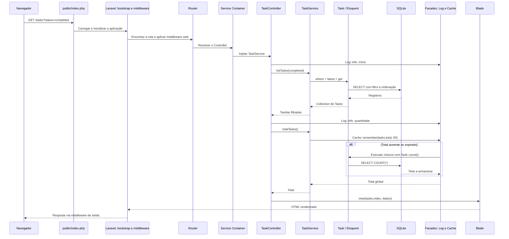

# Demonstração prática — aproximadamente quatro minutos

Este roteiro acompanha o Bloco 4 de `roteiro-apresentacao.md` e utiliza a aplicação descrita em `spec.md`. O foco é uma requisição GET completa, conectando as três demonstrações de padrões ao CRUD.

O cenário local abaixo usa SQLite. Se apresentar a versão hospedada na Vercel, o banco é PostgreSQL, as sessões/cache são compartilhadas no banco e os logs ficam no painel da Vercel. O `/fluxo` se adapta ao driver configurado. As instruções de implantação estão na seção Publicar na Vercel do README.

## Preparação antes da apresentação

- Deixe a aplicação funcionando com `php artisan serve --host=127.0.0.1 --port=8000` e abra http://127.0.0.1:8000/tasks.
- Confirme os cinco exemplos. Se precisar reconstruir o cenário, `php artisan migrate:fresh --seed` apaga os dados atuais e recria os exemplos.
- Abra as abas de código indicadas na tabela abaixo. Não digite código ao vivo.
- Abra `/fluxo` no mesmo navegador e use **Abrir tarefas em outra aba**. Deixe o ritmo **Rápido** para demonstrar o percurso sem alongar a apresentação; pause nas etapas de DI, Active Record e Proxy.
- Em outro terminal, execute `tail -f storage/logs/laravel.log`.
- Deixe preparados os comandos de rotas, SQLite e testes apresentados ao final. Se o tempo estiver apertado, mostre a saída previamente executada dos testes.
- A listagem deve mostrar cinco tarefas no total, duas concluídas e três pendentes. Ao criar a tarefa da demonstração, o contador passa a seis; depois da exclusão, volta a cinco.

## Sequência cronometrada

| Tempo | Arquivo e método em destaque | Ação no navegador ou terminal | Explicação |
| --- | --- | --- | --- |
| 0:00–0:25 | Árvore de `app/`, `resources/views/`, `routes/`, `database/`, `public/` | Mostre a listagem inicial. | “É um gerenciador de tarefas com SQLite e HTML renderizado por Blade. A organização segue MVC e adiciona um Service para os casos de uso.” |
| 0:25–0:50 | `public/index.php`: `handleRequest()`; `bootstrap/app.php`: `withRouting()`; `routes/web.php`: GET /tasks | Atualize a página e mostre a rota no terminal. | “O ponto de entrada inicializa o framework. Os middlewares participam do processamento, e o Router associa a URL ao Controller.” |
| 0:50–1:20 | `app/Http/Controllers/TaskController.php`: construtor e `index()` | Destaque a assinatura com `TaskService` e as chamadas de log. | **DI / IoC:** “O Service Container cria o Controller e injeta o Service. Não precisamos instanciar a dependência nem configurar um binding para essa classe concreta.” |
| 1:20–1:55 | `app/Services/TaskService.php`: `listTasks()`; `app/Models/Task.php`: herança, fillable e cast | Clique em **Concluídas**, observe apenas os dois exemplos concluídos e mostre o SELECT. | **Active Record:** “O Model representa a tabela e oferece consulta e persistência. O filtro vira WHERE no banco antes de carregar os registros; o Service ordena da tarefa mais recente para a mais antiga.” |
| 1:55–2:20 | `TaskController::index()`: `return view(...)`; `resources/views/tasks/index.blade.php`: `@foreach` e `{{ $task->title }}` | Mostre o HTML na página após o filtro. | “O Controller entrega os modelos à View. Blade renderiza HTML no servidor e escapa os títulos. A resposta volta pelo pipeline de middleware ao navegador.” |
| 2:20–2:55 | `TaskService::totalTasks()`, `createTask()`, `deleteTask()`; logs do Controller | Volte a **Todas**, cadastre **Demonstrar Laravel no IFAL** e mostre o contador 6 e o evento de cadastro. | **Proxy:** “Cache e Log encaminham chamadas a serviços do container. O total fica em cache por 60 segundos e é invalidado ao cadastrar ou excluir. O total continua global quando usamos os filtros.” |
| 2:55–3:30 | `TaskService::updateTask()`, `toggleTask()`, `deleteTask()`; `TaskRequest::rules()` | Edite o título para **Apresentar Laravel no IFAL**, conclua, reabra e exclua a tarefa, confirmando a exclusão. | **Active Record:** destaque `save()` e `delete()`. “O formulário é validado no servidor, as ações usam os métodos HTTP adequados e a exclusão exige confirmação na interface.” |
| 3:30–4:00 | `tests/Feature/TaskManagementTest.php`: testes de listagem e contador; `storage/logs/laravel.log` | Mostre os logs e o resultado dos testes. | “Os logs comprovam a execução, e os testes verificam o comportamento HTTP e a persistência. O container fornece dependências, o Eloquent persiste e as Facades acessam os serviços.” |

Os tempos reservam aproximadamente 240 segundos. Ensaie as trocas de aba e deixe a tarefa da demonstração no topo da lista para facilitar as quatro ações finais.

## Comandos preparados

### Conferir as seis rotas

```sh
php artisan route:list --path=tasks
```

Mostre os nomes, os métodos HTTP e a associação com `TaskController`.

### Acompanhar logs em tempo real

```sh
tail -f storage/logs/laravel.log
```

Ao atualizar a listagem aparecem `Iniciando consulta de tarefas` e `Consulta concluída`. Compare o campo `quantidade` antes e depois de selecionar **Concluídas**. Esse valor é a quantidade filtrada; o contador da tela representa o total global.

As operações geram `Task created`, `Task updated`, `Task status changed` e `Task deleted`, com o `task_id`. O canal `single` está configurado no `.env`.

### Mostrar a consulta e os registros

O método `listTasks()` é a origem da consulta. Para mostrar o SQL gerado pelo mesmo encadeamento do filtro de concluídas:

```sh
php artisan tinker --execute 'dump(\App\Models\Task::query()->where("completed", true)->latest()->orderByDesc("id")->toRawSql());'
```

`toRawSql()` mostra o SQL sem executá-lo; a execução na aplicação acontece com `get()`.

Para consultar os registros persistidos, execute no terminal com SQLite instalado:

```sh
sqlite3 -header -column database/database.sqlite "SELECT id, title, completed, created_at FROM tasks WHERE completed = 1 ORDER BY created_at DESC, id DESC;"
```

Compare os dois títulos com a tela filtrada. Se o utilitário `sqlite3` não estiver disponível, o Tinker pode executar a consulta Eloquent:

```sh
php artisan tinker --execute 'dump(\App\Models\Task::query()->where("completed", true)->latest()->orderByDesc("id")->get(["id", "title", "completed"])->toArray());'
```

### Mostrar testes

```sh
php artisan test --compact tests/Feature/TaskManagementTest.php
```

Resultado verificado da suíte completa: **57 testes aprovados, 322 verificações**, incluindo 16 testes do painel e sete de persistência para a nuvem. O comando acima executa os 34 testes do CRUD; para todos, utilize `php artisan test --compact`. A suíte passou com SQLite e PostgreSQL em bancos isolados, sem apagar o banco da apresentação.

## Diagrama para acompanhar GET /tasks



## Se houver tempo para aprofundar

- No painel `/fluxo`, selecione o POST de cadastro e clique na etapa `TaskService::createTask()`. Mostre o arquivo destacado na árvore, o código real e a etapa seguinte do Eloquent/SQLite. O painel permite explicar essas camadas sem alternar para o editor.
- Selecione uma etapa `Facade::__callStatic()` para inspecionar a implementação real do Proxy. Compare duas listagens e observe que um cache hit não gera uma consulta COUNT.
- A animação é uma reprodução após a resposta. As etapas iniciais de entrada/bootstrap são ilustrativas, e o redirecionamento 302 e o GET seguinte são requisições diferentes.

- Abra `vendor/laravel/framework/src/Illuminate/Support/Facades/Facade.php`, no método `__callStatic()`: ele obtém a raiz da Facade e chama o método no serviço real. Classifique **o mecanismo de encaminhamento como Proxy** e explique a diferença para o nome do padrão Facade do GoF.
- `TaskRequest` autoriza acesso público e aplica `required|string|max:255`. As Views utilizam tokens CSRF e `@method('PUT'/'PATCH'/'DELETE')`.
- Tente `/tasks/999999/edit` para mostrar o 404 do Route Model Binding. O método `findTask()` no Service demonstra `findOrFail()`, mas o Controller recebe os modelos diretamente pelo binding.
- Não há Repository: essa camada não acrescentaria valor suficiente ao exemplo acadêmico.
- A invalidação do cache pertence ao Service. Se editar o banco diretamente, o contador pode levar até 60 segundos para refletir a mudança. A listagem consulta o banco a cada requisição.
- Sessão, cache e logs usam arquivos locais; não há autenticação nem serviços externos.

Referências: [ciclo HTTP do Laravel 13](https://laravel.com/docs/13.x/lifecycle), [Service Container](https://laravel.com/docs/13.x/container), [Eloquent](https://laravel.com/docs/13.x/eloquent) e [Facades](https://laravel.com/docs/13.x/facades).
